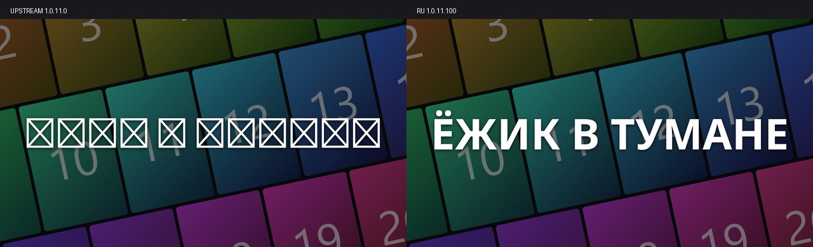

# Library Collage RU

Плагин Jellyfin, который собирает обложки библиотек из их постеров. Форк [Library Collage от digital-workshop](https://github.com/digital-workshop/jellyfin-plugin-library-collage) добавляет кириллицу и расширенные настройки заголовков. Коллажи формируются локально на сервере.



[Сравнение в стиле Label](docs/before-after-label.jpg)

## Установка

Тестовая сборка **1.0.11.100** рассчитана на **Jellyfin 12.4.0 / .NET 10**. ABI плагина — **12.4.0.0**. SkiaSharp **3.119.4** предоставляет сервер Jellyfin. В GitHub Releases сборка пока не опубликована.

При переходе с оригинала 1.0.11.0 сохраните снимок `/config` и установите форк как замену. GUID и имя сборки совпадают, поэтому Jellyfin может использовать прежнюю конфигурацию. Оставляйте в каталоге плагинов только один экземпляр Library Collage. Подробные команды и процедура возврата к оригиналу приведены в [инструкции для Jellyfin Docker](docs/INSTALL-DOCKER-RU.md).

## Настройка

Откройте **Dashboard → Plugins → Library Collage**. Можно выбирать библиотеки, макет коллажа, способ подбора постеров, затемнение и условия перезаписи. **Overwrite anyway** разрешает заменить собственную обложку конкретной библиотеки.

- В разделе **Text** доступны стили Poster, Classic, Netflix и Label, выбор шрифта, размер, цвет, тень, обводка, выравнивание, положение и регистр заголовка.
- **Same font size for all libraries** предпочитает перенос при общем размере. При выключенном **Auto-shrink** длинный текст тоже сначала переносится. В обоих режимах размер уменьшается, если иначе заголовок не помещается на холсте.
- В **Title overrides → Customize** можно изменить шрифт, размер, положение и видимость заголовка одной библиотеки или задать свой текст, сохранив имя библиотеки в Jellyfin.
- **Preview** показывает текущие настройки формы без их сохранения и без изменения обложки. **Generate** сохраняет настройки и создаёт обложку выбранной библиотеки с учётом правил перезаписи.

## Кириллица и шрифты

Noto Sans Bold — шрифт по умолчанию и запасной шрифт для отсутствующих глифов, в том числе кириллицы в Bebas Neue. Встроенные файлы покрывают русский алфавит с Ё/ё, латиницу, цифры и распространённую пунктуацию. Символы вне охвата отображаются знаком замены. Сложное формирование письменностей, двунаправленный текст и цветные эмодзи не поддерживаются.

Все пять шрифтов распространяются на условиях **SIL Open Font License 1.1**. Тексты лицензий и сведения об авторах находятся в [Rendering/Fonts](Jellyfin.Plugin.LibraryCollage/Rendering/Fonts) и в установочном ZIP.

| Шрифт | Официальный источник и подготовка |
|---|---|
| Noto Sans Bold | [Google Fonts / Noto Project](https://github.com/google/fonts/tree/main/ofl/notosans), статическое начертание 700, стандартная ширина |
| IBM Plex Sans Bold | [IBM Plex](https://github.com/IBM/plex/tree/master/packages/plex-sans/fonts/complete/ttf), оригинальный статический TTF |
| Montserrat Bold | [Google Fonts / Montserrat.Git](https://github.com/google/fonts/tree/main/ofl/montserrat), статическое начертание 700 |
| Roboto Condensed Bold | [Google Fonts / Roboto Project](https://github.com/google/fonts/tree/main/ofl/robotocondensed), статическое начертание 700 |
| Bebas Neue | [Dharma Type](https://github.com/dharmatype/Bebas-Neue), оригинальный TTF из upstream, кириллица подставляется через Noto Sans |

Статические начертания из variable TTF получены с помощью FontTools.


## Сборка и проверка

Из корня репозитория с установленным .NET 10 SDK:

```sh
dotnet build -c Release
dotnet test
```

DLL появится в `Jellyfin.Plugin.LibraryCollage/bin/Release/net10.0/`. Для ручной установки используйте DLL вместе с [docs/meta.json](docs/meta.json). При распространении сборки приложите GPL-3.0, лицензии шрифтов и предоставьте соответствующие исходники. Примеры, созданные тестами, сохраняются в `samples/`.

Локальная сборка и 51 тест прошли под Windows. Тесты проверяют глифы и рендеринг 1920×1080 во всех четырёх стилях. Linux x64 и ARM64 включены в матрицу CI. Проверка загрузки плагина на Jellyfin Docker с темой Flow на Raspberry Pi ещё предстоит.

## Лицензия и авторство

Плагин распространяется по [GPL-3.0](LICENSE). Исходный проект разработан [digital-workshop](https://github.com/digital-workshop/jellyfin-plugin-library-collage). Шрифты распространяются по собственным лицензиям SIL OFL 1.1.
