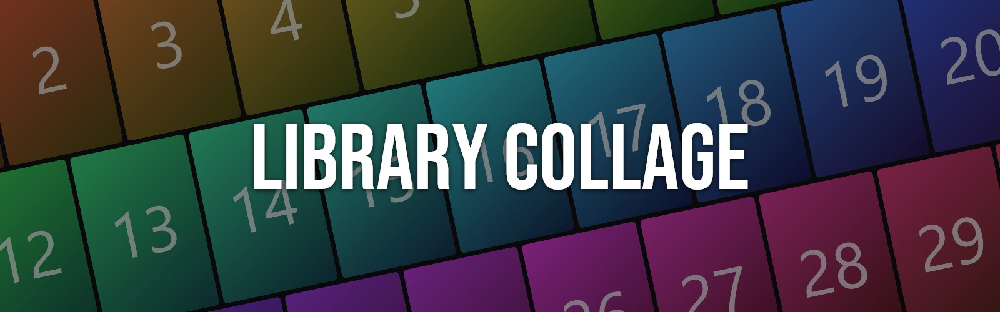
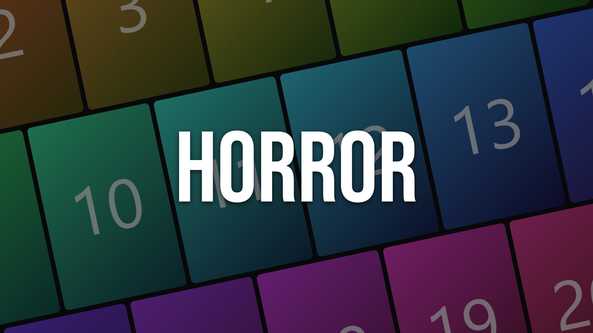
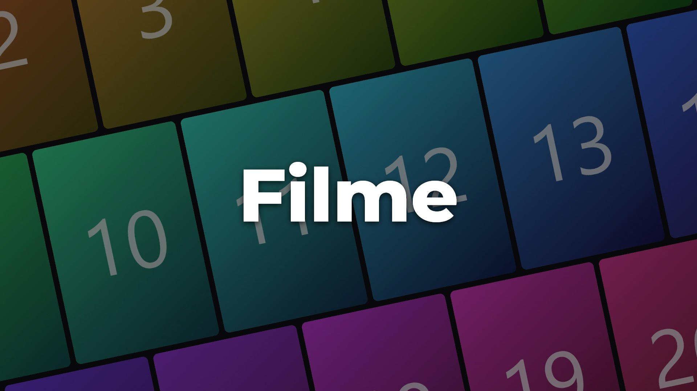
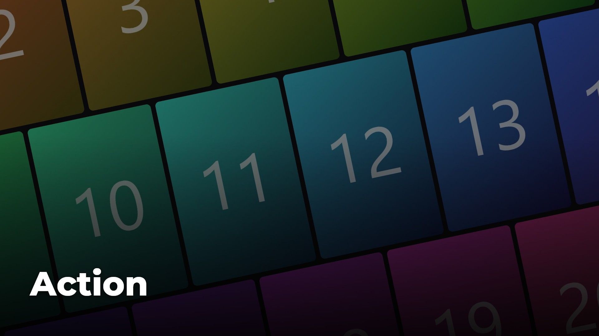
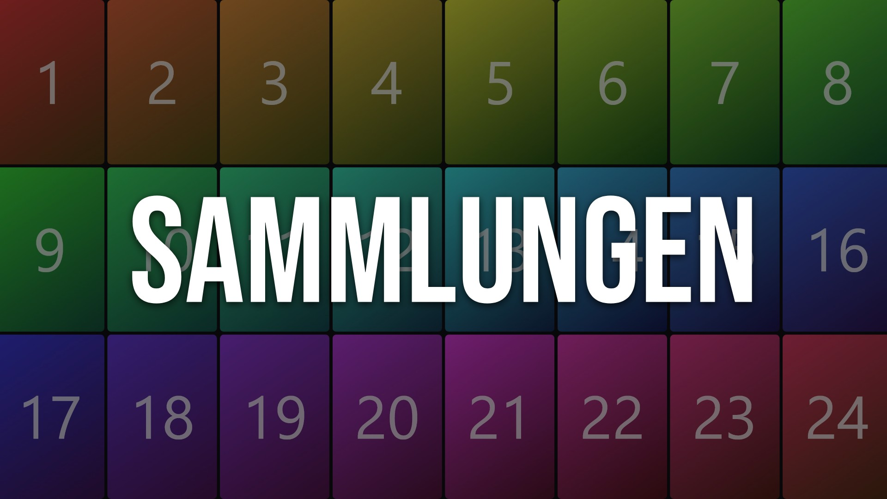

<div align="center">
  
</div>

<hr style="background-color:#b4c5fb; height:3px; border:none;">

<div align="center">

**Automatic poster-collage cover images for your Jellyfin libraries.**

</div>

Library Collage replaces the plain tiles under **My Media** with a generated cover image. Each cover is a tilted collage of the library's posters, darkened so the library name on top stays readable. It refreshes on a schedule, so your home screen stays up to date as your libraries grow.

Requires **Jellyfin 12.2**.

## Table of Contents

- [Installation](#installation)
- [Configuration](#configuration)
- [Styles](#styles)
- [How It Works](#how-it-works)
- [Uninstallation](#uninstallation)
- [FAQ](#faq)
- [Development](#development)
- [License & Acknowledgments](#license--acknowledgments)

<hr style="background-color:#b4c5fb; height:2px; border:none;">

## Installation

### Prerequisites

- Jellyfin Server **12.2** or newer
- Administrator access to the Jellyfin dashboard

### Setup Instructions

1. Open **Dashboard → Plugins → Repositories** and click **+**.
2. Enter any name, for example `Library Collage`, and this repository URL:
   ```
   https://raw.githubusercontent.com/digital-workshop/jellyfin-plugin-library-collage/main/manifest.json
   ```
3. Go to **Dashboard → Plugins → Catalog** and install **Library Collage**.
4. Restart Jellyfin.
5. Open **Dashboard → Plugins → Library Collage**, choose your libraries, and click **Save & generate now**.

<hr style="background-color:#b4c5fb; height:2px; border:none;">

## Configuration

All settings are on the plugin's settings page.

| Setting | Default | Description |
|---|---|---|
| **Libraries** | Movie libraries on | Choose which libraries get a collage. |
| **Overwrite anyway** | Off | Per library. Replaces an image that the plugin did not create. |
| **Preview** | – | Per library. Renders the collage with the current settings without changing anything. |
| **Layout** | Tilted posters | *Tilted posters* or *Straight grid*. |
| **Poster selection** | Random from top rated | *Random from top rated*, *Random*, *Recently added*, or *Top rated*. |
| **Top rated: best X %** | 50 | The share of the library that *Random from top rated* picks from. |
| **Minimum titles with poster** | 4 | Libraries with fewer titles are skipped. Missing slots are filled with repeats. |
| **Darkening** | 50 % | Strength of the dark overlay. |
| **Write library name** | On | Turns the text off if your theme already shows the name. |
| **Text style** | Poster | *Poster*, *Classic*, or *Netflix*. See below. |

<hr style="background-color:#b4c5fb; height:2px; border:none;">

## Styles

<table>
  <tr>
    <td align="center" width="50%">
      <br>
      <b>Poster</b>: condensed, upper case (default)
    </td>
    <td align="center" width="50%">
      <br>
      <b>Classic</b>: bold and centered
    </td>
  </tr>
  <tr>
    <td align="center" width="50%">
      <br>
      <b>Netflix</b>: bottom left with a gradient
    </td>
    <td align="center" width="50%">
      <br>
      <b>Straight grid</b> layout
    </td>
  </tr>
</table>

<sub>The sample images use placeholder posters. On your server the collage uses your real posters.</sub>

<hr style="background-color:#b4c5fb; height:2px; border:none;">

## How It Works

- **Poster sources:** Movie libraries use movie posters, TV libraries use series posters, collection libraries use collection posters, and mixed libraries use both movies and series.
- **Output:** A 1920×1080 JPEG, set as the library's primary image.
- **Text fitting:** Long library names shrink to fit or wrap onto two lines.
- **Small libraries:** Posters repeat to fill the collage, and the same poster is never placed right next to itself.
- **Your own images are safe:** The plugin remembers which images it created, by path and hash. If a library has an image from anywhere else, the plugin leaves it alone unless you tick **Overwrite anyway**.
- **Scheduled task:** The task *Generate library collages* runs every Sunday at 04:00. Change or add triggers under **Dashboard → Scheduled Tasks**. With random selection, each run produces a fresh mix.

<hr style="background-color:#b4c5fb; height:2px; border:none;">

## Uninstallation

1. Go to **Dashboard → Plugins**, open **Library Collage**, and click **Uninstall**.
2. Restart Jellyfin.
3. Generated images stay on your libraries. To remove them, open a library's **Edit images** dialog in the web UI and delete or replace the image.

<hr style="background-color:#b4c5fb; height:2px; border:none;">

## FAQ

> ### The library name appears twice.

Your theme or custom CSS probably draws the library name on the tile as well. Either turn off **Write library name** in the plugin settings, or remove the overlay from your CSS.

> ### A library is not updated.

Check its status on the settings page:

- **🔒 Own image:** The library already has an image the plugin did not create. Tick **Overwrite anyway**.
- **Too few titles:** The library has fewer titles with a poster than the configured minimum.

The Jellyfin log shows a line starting with `Library Collage:` for each library that was skipped and why.

> ### The image does not change in my app.

Clients cache images. Reload the web UI, or restart the app.

> ### Can I change the schedule?

Yes. Go to **Dashboard → Scheduled Tasks → Library Collage → Generate library collages**.

<hr style="background-color:#b4c5fb; height:2px; border:none;">

## Development

```
dotnet build -c Release
dotnet test
```

The tests render sample images into `samples/`.

**Releasing:** Push a tag such as `v1.0.1`. The *Release* workflow runs the tests, builds the plugin, publishes a GitHub release with the zip, and adds the version to `manifest.json`. An annotated tag's message becomes the changelog.

<hr style="background-color:#b4c5fb; height:2px; border:none;">

## License & Acknowledgments

Licensed under **GPL-3.0**, like Jellyfin itself.

- [Jellyfin](https://jellyfin.org): the plugin API and SkiaSharp image rendering
- [Bebas Neue](https://github.com/dharmatype/Bebas-Neue) and [Montserrat](https://github.com/JulietaUla/Montserrat): bundled fonts, SIL Open Font License
